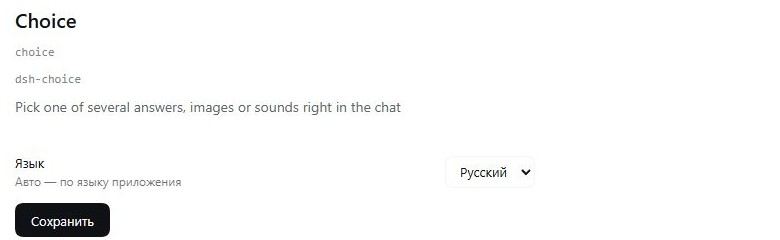

# dsh-choice

A single-choice board inside the DeepSeek Harness chat, next to the built-in `ask_user_question`.

```
ask_user_choice({ title, subtitle?, options, noneLabel? })
```

Every option is **text**, an **image** or a **sound**. The card is posted as a normal chat
row, the user presses the check icon on one row, and the choice comes back as an ordinary
chat message that starts the next turn.

## Behaviour

- **one pick per board** — the check button on the chosen row; other rows become inert;
- **«none of these»** — a trailing row with its label from `noneLabel`;
- sounds and image previews stay usable after the pick;
- **non-blocking** — the tool returns immediately, unlike `ask_user_question`, which waits
  for the answer inside the turn;
- **subagents are refused** — only the main agent can show a board:
  `human interaction is unavailable while the calling agent is owned by another live agent…`.

All visible text (title, subtitle, option titles and descriptions, `noneLabel`) comes from
the agent, in the language of the conversation.

## Card

Rows: a 52 px preview (image thumbnail or ▶ button), the title and description, and the
round check button on the right. Clicking an image opens a lightbox; pressing ▶ plays the
sound with a plain `Audio` object, so there is no extra UI. A pick replaces the drafts
carefully: the composer keeps its text, the choice is sent as its own message.

## Options

```jsonc
{
  "kind": "text",              // required: text | image | audio
  "title": "Keep as is",       // row label
  "description": "…",          // optional second line
  "value": "…",                // text sent to the chat (defaults to title)
  "src": "C:\\sounds\\a.wav"   // image/audio: http(s) URL or absolute local path
}
```

Local files are copied into `%LOCALAPPDATA%\dsh-choice\media` and served over loopback.

## Bridge

`127.0.0.1:49236`:

| Method | Path | Purpose |
|---|---|---|
| `GET` | `/status` | port and media counter |
| `GET` | `/media/<file>` | served image or audio |
| `POST` | `/attach` | copy a local file and return its URL |
| `GET` | `/settings` | stored settings (`language`) |
| `POST` | `/settings` | save `language`: `ru`, `en`, `zh` or `auto` |

## Settings

The plugin row config (`plugins.row.config`) holds one control: the interface language —
Русский, English, 中文 or Авто. It is stored in `%LOCALAPPDATA%\dsh-choice\settings.json`
and applies to the card and the form without a restart.

The language is resolved in this order:

1. the saved `language`, when it is `ru`, `en` or `zh`;
2. `auto` — the application language: `document.documentElement.lang`, then
   `navigator.language`; `ru*` → ru, `zh*` → zh, anything else → en;
3. nothing stored — `ru`.

All card text (title, subtitle, option titles and descriptions, `noneLabel`) comes from the
agent, in the language of the conversation; only the plugin's own labels — the pick, play
and open buttons and the settings row — follow the language above.

## Languages

The interface speaks Russian, English and Chinese. The language comes from the
extension setting when it is `ru`, `en` or `zh`; `auto` follows the application
language (`document.documentElement.lang`, then `navigator.language`; `ru*` → ru,
`zh*` → zh, anything else → en); with nothing stored it is `ru`. Change it in
**Plugins → Choice**; the value lives in `%LOCALAPPDATA%\dsh-choice\settings.json`
and applies without a restart.

## Screenshots



## Install

```json
"@machine202502/dsh-choice": "^0.1.1"
```

and add `dsh-choice` to `dsh.profile.bundles`. A restart is required for the host half to
load; the client half reloads with the page.

## License

MIT.
