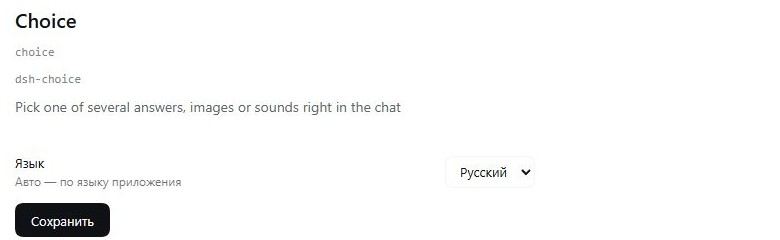

# dsh-choice

Доска выбора одного варианта внутри чата DeepSeek Harness, рядом со встроенным
`ask_user_question`.

```
ask_user_choice({ title, subtitle?, options, noneLabel? })
```

Каждый вариант — **текст**, **картинка** или **звук**. Карточка появляется обычной
строкой в чате, пользователь нажимает галочку на одном ряду, и выбор приходит
обычным сообщением, которое начинает следующий ход.

## Поведение

- **один выбор на доску** — галочка на выбранном ряду, остальные становятся
  неактивными;
- **«ничего из этого»** — дополнительный ряд, подпись берётся из `noneLabel`;
- звуки и превью картинок остаются доступными после выбора;
- **не блокирует** — инструмент возвращается сразу, в отличие от
  `ask_user_question`, который ждёт ответа внутри хода;
- **сабагентам отказано** — доску показывает только основной агент:
  `human interaction is unavailable while the calling agent is owned by another live agent…`.

Весь видимый текст (заголовок, подзаголовок, названия и описания вариантов,
`noneLabel`) приходит от агента на языке разговора.

## Карточка

Ряды: превью 52 px (миниатюра картинки или кнопка ▶), заголовок и описание, справа
круглая кнопка-галочка. Клик по картинке открывает просмотр; ▶ проигрывает звук
обычным `Audio`, без дополнительного интерфейса. Выбор аккуратно заменяет черновики:
текст в композере сохраняется, выбор уходит отдельным сообщением.

## Варианты

```jsonc
{
  "kind": "text",              // обязателен: text | image | audio
  "title": "Оставить как есть",// подпись ряда
  "description": "…",          // необязательная вторая строка
  "value": "…",                // текст, который уйдёт в чат (по умолчанию title)
  "src": "C:\\sounds\\a.wav"   // image/audio: http(s)-ссылка или абсолютный путь
}
```

Локальные файлы копируются в `%LOCALAPPDATA%\dsh-choice\media` и отдаются через
loopback.

## Мост

`127.0.0.1:49236`:

| Метод | Путь | Назначение |
|---|---|---|
| `GET` | `/status` | порт и счётчик медиа |
| `GET` | `/media/<file>` | отдача картинки или звука |
| `POST` | `/attach` | скопировать локальный файл и вернуть ссылку |
| `GET` | `/settings` | сохранённые настройки (`language`) |
| `POST` | `/settings` | сохранить `language`: `ru`, `en`, `zh` или `auto` |

## Настройки

В форме плагина (`plugins.row.config`) один контрол — язык интерфейса: Русский,
English, 中文 или Авто. Хранится в `%LOCALAPPDATA%\dsh-choice\settings.json` и
применяется к карточке и форме без перезапуска.

Язык выбирается в таком порядке:

1. сохранённый `language`, если это `ru`, `en` или `zh`;
2. `auto` — язык приложения: `document.documentElement.lang`, затем
   `navigator.language`; `ru*` → ru, `zh*` → zh, всё остальное → en;
3. ничего не сохранено — `ru`.

## Скриншоты



## Установка

```json
"dsh-choice": "github:machine202502/dsh-choice#main"
```

и добавить `dsh-choice` в `dsh.profile.bundles`. Для загрузки хост-части нужен
перезапуск; клиентская часть перезагружается вместе со страницей.

## Лицензия

MIT.
